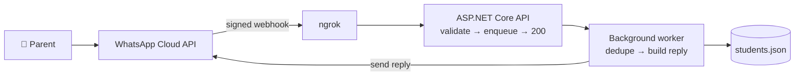

# academy-whatsapp-bot

[](https://github.com/juancitowillyr46/academy-whatsapp-bot/actions/workflows/ci.yml)

[](LICENSE)

WhatsApp bot (proof of concept) for a sports academy: parents text **"saldo"** and instantly get their children's outstanding balance and a payment link, with no staff involved.

> **The demo runs locally on demand** (ASP.NET Core + ngrok), so the bot is not online all the time. See the recording below, or follow the steps to run it yourself.

## Demo

<p align="center">
  
</p>

Real WhatsApp conversation with the bot (fake student data). A parent with two children gets one message: the pending balance with its payment link, and "al día" for the child who is up to date. Any other message gets a help reply; unknown phone numbers are told to contact the academy.

## How it works



1. Meta posts each incoming message to `POST /webhook`.
2. The API checks the `X-Hub-Signature-256` HMAC signature, queues the message and answers `200` immediately.
3. A background worker skips duplicates, finds the guardian's active students by phone and replies through the Graph API.

More detail in [docs/architecture.md](docs/architecture.md).

## Highlights

- **Webhook security**: HMAC-SHA256 signature validation over the raw body with constant-time comparison; unsigned requests get `401`.
- **Fast webhook responses**: `System.Threading.Channels` + `BackgroundService` decouple receiving from processing, so Meta never retries because of a slow reply.
- **Idempotency**: repeated message ids are ignored (`IMemoryCache`).
- **Fail-fast configuration**: options validated at startup; secrets kept in User Secrets, never in the repo.
- **Privacy**: phone numbers masked in logs, fake data only in the repository.
- **Tests**: 42 xUnit tests, including integration tests that run the real API in memory with `WebApplicationFactory` and signed Meta payloads.
- **CI**: GitHub Actions checks formatting, builds with warnings as errors and runs all tests.

## Tech stack

.NET 10 · ASP.NET Core Minimal API · WhatsApp Cloud API (Meta) · System.Threading.Channels · xUnit · GitHub Actions · ngrok

| Decision | Why |
|---|---|
| Single Minimal API project | A proof of concept should stay small and easy to read |
| In-process queue instead of a broker | Fast webhook replies with zero infrastructure |
| Keyword rules instead of an LLM | Predictable and free for phase 1; an AI agent is on the roadmap |
| Local + ngrok instead of cloud hosting | Only needed during demos, no hosting cost |

## Run it locally

**Prerequisites:** [.NET 10 SDK](https://dotnet.microsoft.com/download), a [Meta developer app](https://developers.facebook.com) with WhatsApp, and [ngrok](https://ngrok.com).

```bash
# 1. Secrets (from src/AcademyWhatsAppBot.Api)
dotnet user-secrets set "WhatsApp:AccessToken" "<token>"
dotnet user-secrets set "WhatsApp:PhoneNumberId" "<phone-number-id>"
dotnet user-secrets set "WhatsApp:AppSecret" "<app-secret>"
dotnet user-secrets set "WhatsApp:VerifyToken" "<any-string>"
dotnet user-secrets set "WhatsApp:GraphApiVersion" "<vXX.X>"

# 2. Run the API (port 5000)
dotnet run --project src/AcademyWhatsAppBot.Api

# 3. Expose it
ngrok http 5000 --url https://<your-ngrok-domain>
```

Then register `https://<your-ngrok-domain>/webhook` in the Meta dashboard and subscribe to `messages`. The full one-time setup and troubleshooting guide is in [docs/demo-checklist.md](docs/demo-checklist.md).

To try it with your own phone, copy `data/students.json` to `data/students.local.json` (git-ignored), add your number and set `Data:FilePath` to `../../data/students.local.json` in User Secrets.

```bash
dotnet test   # 42 tests, no secrets or network needed
```

## Project structure

```
src/AcademyWhatsAppBot.Api/
├── Webhook/      GET verification, POST reception, signature validation
├── Processing/   in-memory queue and background worker
├── Balance/      reply logic and Spanish user-facing texts
├── Data/         student model and JSON repository
├── WhatsApp/     Graph API client and options
└── Common/       phone/text normalization, es-CO formats
tests/AcademyWhatsAppBot.Tests/
├── Unit/
├── Integration/  WebApplicationFactory + fake WhatsApp client
└── Fixtures/     sample Meta payloads
```

## Roadmap

- [x] **Phase 1 – Rule-based bot (current):** balance check by keywords, runs locally on demand.
- [ ] **Phase 2 – AI agent:** LLM with tool calling to query real data, human handoff, guardrails.
- [ ] **Phase 3 – Proactive & real data:** payment reminders with approved templates, Google Sheets, receipt handling.

## License

[MIT](LICENSE)
