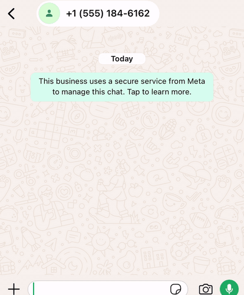
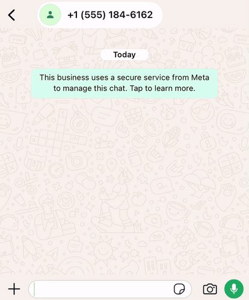
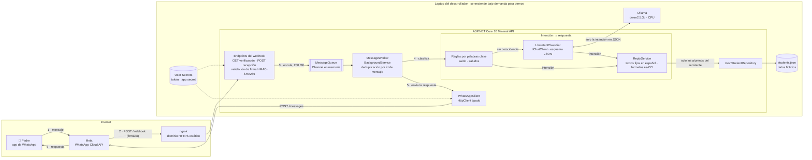

# academy-whatsapp-bot

[](https://github.com/juancitowillyr46/academy-whatsapp-bot/actions/workflows/ci.yml)

[](LICENSE)

Bot de WhatsApp (prueba de concepto) para una academia deportiva: los padres consultan su saldo con sus propias palabras y reciben al instante lo que debe cada hijo y un enlace de pago, sin que intervenga el personal. Los mensajes libres los entiende un **modelo de lenguaje local** (Ollama), mientras que cada respuesta y cada monto salen del código y de los datos.

> **La demo se ejecuta localmente bajo demanda** (ASP.NET Core + ngrok + Ollama), así que el bot no está en línea todo el tiempo. Mira las grabaciones de abajo o sigue los pasos para ejecutarlo tú mismo.

## Demo

Conversaciones reales de WhatsApp con el bot (datos de alumnos ficticios). Una grabación por fase, para que se vea cómo evolucionó.

<table>
  <tr>
    <th>Fase 1 · Reglas</th>
    <th>Fase 2 · IA local</th>
  </tr>
  <tr>
    <td align="center"></td>
    <td align="center"></td>
  </tr>
  <tr>
    <td valign="top">Solo palabras clave. "saldo" devuelve un único mensaje para un padre con dos hijos: el saldo pendiente con su enlace de pago y "al día" para el hijo que no debe nada. Cualquier otro mensaje recibe el texto de ayuda.</td>
    <td valign="top">Mensajes libres entendidos por un modelo local, con cuatro intenciones: saludo, consulta de saldo con las palabras del padre, aviso de pago derivado a una persona y una petición fuera de tema redirigida con amabilidad. Se recortó el tiempo de espera del modelo.</td>
  </tr>
</table>

## Arquitectura



1. Meta envía cada mensaje entrante a `POST /webhook`.
2. La API valida la firma HMAC `X-Hub-Signature-256`, encola el mensaje y responde `200` de inmediato.
3. Un proceso en segundo plano descarta duplicados y averigua **qué quiere el padre**: primero con reglas por palabras clave y, para todo lo demás, con un modelo local.
4. El código arma la respuesta para esa intención (estado de cuenta, derivación a una persona, saludo, fuera de tema) con los datos del propio remitente y la envía por la Graph API.

Más detalle en [docs/architecture.md](docs/architecture.md) (en inglés).

## IA: un modelo local que clasifica, nunca redacta

| El padre escribe | Lo decide | Respuesta |
|---|---|---|
| "saldo" | Reglas (al instante, gratis) | Su estado de cuenta |
| "¿hasta cuándo puedo pagar?" | Modelo local → `balance` | Su estado de cuenta |
| "Ya hice la transferencia" | Modelo local → `handoff` | "Una persona revisará tu mensaje" (queda registrado) |
| "Buenas tardes" | Reglas → `greeting` | Presentación breve |
| "Recomiéndame una película" | Modelo local → `off_topic` | Redirección amable |

- El modelo (`qwen2.5:3b` en Ollama, detrás de `IChatClient` de `Microsoft.Extensions.AI`) debe responder con un **esquema JSON limitado a cuatro intenciones**. Nunca escribe textos, montos ni nombres, así que no puede inventar un saldo ni filtrar datos de otra familia, y una inyección de prompt no tiene nada que extraer.
- Este diseño salió de medir: cuando se dejó que los modelos locales redactaran las respuestas, `llama3.1:8b` **inventó un monto y una fecha de vencimiento**. Detalles en [docs/architecture.md](docs/architecture.md#reply-logic-iintentclassifier--replyservice).
- Si el modelo falla o tarda, el bot recurre a las reglas y responde igual. Funciona en una laptop solo con CPU, a ~1,5 s por llamada al modelo y sin costo.
- **Evals:** 40 mensajes etiquetados, **77,5 % → 90 %** tras un ajuste guiado por las evals (los saludos pasaron a reglas). Ver [evals/](evals/README.md).

## Puntos destacados

- **Seguridad del webhook**: validación de firma HMAC-SHA256 sobre el cuerpo original con comparación en tiempo constante; las peticiones sin firma reciben `401`.
- **Webhook rápido**: `System.Threading.Channels` + `BackgroundService` separan la recepción del procesamiento, así Meta nunca reintenta por una respuesta lenta.
- **Idempotencia**: los ids de mensaje repetidos se ignoran (`IMemoryCache`).
- **IA segura por diseño**: el modelo solo elige una intención; las respuestas usan únicamente los datos del remitente de WhatsApp.
- **Independiente del proveedor**: cambiar Ollama por otro `IChatClient` (APIs compatibles con OpenAI, Claude...) es solo un cambio de registro.
- **Configuración que falla rápido**: las opciones se validan al arrancar; los secretos están en User Secrets, nunca en el repositorio.
- **Privacidad**: el modelo corre en local, los números de teléfono se enmascaran en los logs y el repositorio solo tiene datos ficticios.
- **Pruebas**: 72 pruebas xUnit, incluidas pruebas de integración que levantan la API real en memoria con `WebApplicationFactory` y payloads de Meta firmados, y un cliente de chat falso para el modelo.
- **CI**: GitHub Actions revisa el formato, compila con las advertencias tratadas como errores y ejecuta todas las pruebas (sin necesidad del modelo).

## Tecnologías

.NET 10 · ASP.NET Core Minimal API · WhatsApp Cloud API (Meta) · Microsoft.Extensions.AI · Ollama (qwen2.5:3b) · System.Threading.Channels · xUnit · GitHub Actions · ngrok

| Decisión | Por qué |
|---|---|
| Un solo proyecto Minimal API | Una prueba de concepto debe ser pequeña y fácil de leer |
| Cola en el mismo proceso en lugar de un broker | Respuestas rápidas al webhook sin infraestructura adicional |
| El LLM clasifica la intención y el código redacta | Los modelos locales pequeños alucinan al escribir sobre dinero; elegir entre opciones fijas es fiable y seguro |
| Reglas antes que el modelo | Las frases cerradas (palabras clave, saludos) son gratis, instantáneas y siempre aciertan |
| Modelo local (Ollama) en lugar de una API de pago | Costo cero y los datos no salen de la máquina; gracias a `IChatClient`, usar un modelo alojado es un solo cambio |
| Local + ngrok en lugar de hosting en la nube | Solo se necesita durante las demos, sin costo de hosting |

## Ejecutarlo en local

**Requisitos:** [.NET 10 SDK](https://dotnet.microsoft.com/download), una [app de Meta for Developers](https://developers.facebook.com) con WhatsApp, [ngrok](https://ngrok.com) y, para los mensajes libres, [Ollama](https://ollama.com) con `ollama pull qwen2.5:3b`.

```bash
# 1. Secretos (desde src/AcademyWhatsAppBot.Api)
dotnet user-secrets set "WhatsApp:AccessToken" "<token>"
dotnet user-secrets set "WhatsApp:PhoneNumberId" "<phone-number-id>"
dotnet user-secrets set "WhatsApp:AppSecret" "<app-secret>"
dotnet user-secrets set "WhatsApp:VerifyToken" "<cualquier-texto>"
dotnet user-secrets set "WhatsApp:GraphApiVersion" "<vXX.X>"

# 2. Ejecutar la API (puerto 5000; en Development usa Ollama, pon Ai:Provider en None para usar solo reglas)
dotnet run --project src/AcademyWhatsAppBot.Api

# 3. Exponerla
ngrok http 5000 --url https://<tu-dominio-ngrok>
```

Después registra `https://<tu-dominio-ngrok>/webhook` en el panel de Meta y suscríbete a `messages`. La guía completa de configuración inicial y solución de problemas está en [docs/demo-checklist.md](docs/demo-checklist.md) (en inglés).

Para probarlo con tu propio teléfono, copia `data/students.json` a `data/students.local.json` (ignorado por git), agrega tu número y define `Data:FilePath` como `../../data/students.local.json` en User Secrets.

```bash
dotnet test                                              # 72 pruebas, sin secretos, red ni modelo
dotnet run --project tools/AcademyWhatsAppBot.Evals -- --label my-run   # evals de intención (necesita Ollama)
```

## Estructura del proyecto

```
src/AcademyWhatsAppBot.Api/
├── Webhook/      verificación GET, recepción POST, validación de firma
├── Processing/   cola en memoria y proceso en segundo plano
├── Intents/      reglas por palabras clave, clasificador LLM local, respaldo híbrido
├── Replies/      intención → respuesta, textos en español para el usuario
├── Data/         modelo de alumno y repositorio JSON
├── WhatsApp/     cliente de la Graph API y opciones
└── Common/       normalización de teléfonos y textos, formatos es-CO
tests/AcademyWhatsAppBot.Tests/
├── Unit/
├── Integration/  WebApplicationFactory + cliente de WhatsApp falso
└── Fixtures/     payloads de ejemplo de Meta
tools/AcademyWhatsAppBot.Evals/   ejecutor de evals (clasificador real + Ollama)
evals/                            casos etiquetados y resultados
```

## Hoja de ruta

- [x] **Fase 1 – Bot basado en reglas**
  - [x] Webhook firmado (HMAC-SHA256), cola en segundo plano y deduplicación
  - [x] Estado de cuenta por palabras clave: hermanos en un solo mensaje, al día, teléfono desconocido
  - [x] Pruebas unitarias y de integración, CI con GitHub Actions, GIF de la demo
- [x] **Fase 2 – IA local** (actual)
  - [x] Mensajes libres clasificados por un LLM local (Ollama `qwen2.5:3b`, salida con esquema JSON)
  - [x] Respuestas para derivación a una persona, saludos y mensajes fuera de tema
  - [x] `IChatClient` independiente del proveedor, con respaldo en reglas si el modelo falla
  - [x] Evals: 40 mensajes etiquetados, 77,5 % → 90 % tras un ajuste guiado por las evals
  - [x] GIF de la demo con las cuatro intenciones
- [ ] **Fase 3 – Agente conversacional**
  - [ ] Memoria corta de la conversación por teléfono
  - [ ] Conjunto de evaluación aparte con frases nuevas
  - [ ] Modelo alojado opcional detrás del mismo `IChatClient`
- [ ] **Fase 4 – Proactivo y datos reales**
  - [ ] Recordatorios de pago con plantillas aprobadas
  - [ ] Google Sheets como fuente de datos
  - [ ] Recepción de comprobantes de pago (imagen)

## Licencia

[MIT](LICENSE)
