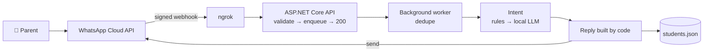

# academy-whatsapp-bot

[](https://github.com/juancitowillyr46/academy-whatsapp-bot/actions/workflows/ci.yml)

[](LICENSE)

WhatsApp bot (proof of concept) for a sports academy: parents ask about their balance in their own words and instantly get each child's outstanding amount and a payment link, with no staff involved. Free-form messages are understood by a **local language model** (Ollama), while every reply and amount comes from code and data.

> **The demo runs locally on demand** (ASP.NET Core + ngrok + Ollama), so the bot is not online all the time. See the recording below, or follow the steps to run it yourself.

## Demo

<p align="center">
  
</p>

Real WhatsApp conversation with the bot (fake student data; recorded in phase 1, before greetings got their own reply). A parent with two children gets one message: the pending balance with its payment link, and "al día" for the child who is up to date.

## How it works



1. Meta posts each incoming message to `POST /webhook`.
2. The API checks the `X-Hub-Signature-256` HMAC signature, queues the message and answers `200` immediately.
3. A background worker skips duplicates and finds out **what the parent wants**: keyword rules first, a local model for anything else.
4. Code builds the reply for that intent (balance statement, hand-off to a person, greeting, off-topic) from the sender's own data and sends it through the Graph API.

More detail in [docs/architecture.md](docs/architecture.md).

## AI: a local model that classifies, never writes

| Parent writes | Decided by | Reply |
|---|---|---|
| "saldo" | Rules (instant, free) | Their balance statement |
| "¿hasta cuándo puedo pagar?" | Local model → `balance` | Their balance statement |
| "Ya hice la transferencia" | Local model → `handoff` | "A person will review your message" (logged) |
| "Buenas tardes" | Rules → `greeting` | Short introduction |
| "Recomiéndame una película" | Local model → `off_topic` | Polite redirect |

- The model (`qwen2.5:3b` via Ollama, behind `Microsoft.Extensions.AI`'s `IChatClient`) must answer with a **JSON schema limited to four intents**. It never writes text, amounts or names, so it can't invent a balance or leak another family's data, and prompt injection has nothing to extract.
- This design came from measurement: when local models were allowed to write replies, `llama3.1:8b` **invented an amount and a due date**. Details in [docs/architecture.md](docs/architecture.md#reply-logic-iintentclassifier--replyservice).
- If the model fails or is slow, the bot falls back to rules and still answers. Runs on a CPU-only laptop at ~1.5 s per model call, at zero cost.
- **Evals:** 40 labeled messages, **77.5% → 90%** after an eval-driven fix (greetings moved to rules). See [evals/](evals/README.md).

## Highlights

- **Webhook security**: HMAC-SHA256 signature validation over the raw body with constant-time comparison; unsigned requests get `401`.
- **Fast webhook responses**: `System.Threading.Channels` + `BackgroundService` decouple receiving from processing, so Meta never retries because of a slow reply.
- **Idempotency**: repeated message ids are ignored (`IMemoryCache`).
- **Safe AI by design**: the model only picks an intent; replies use the WhatsApp sender's own data.
- **Provider-agnostic**: swapping Ollama for another `IChatClient` (OpenAI-compatible APIs, Claude...) is a registration change.
- **Fail-fast configuration**: options validated at startup; secrets kept in User Secrets, never in the repo.
- **Privacy**: the model runs locally, phone numbers are masked in logs, and only fake data is in the repository.
- **Tests**: 72 xUnit tests, including integration tests that run the real API in memory with `WebApplicationFactory` and signed Meta payloads, and a fake chat client for the model.
- **CI**: GitHub Actions checks formatting, builds with warnings as errors and runs all tests (no model needed).

## Tech stack

.NET 10 · ASP.NET Core Minimal API · WhatsApp Cloud API (Meta) · Microsoft.Extensions.AI · Ollama (qwen2.5:3b) · System.Threading.Channels · xUnit · GitHub Actions · ngrok

| Decision | Why |
|---|---|
| Single Minimal API project | A proof of concept should stay small and easy to read |
| In-process queue instead of a broker | Fast webhook replies with zero infrastructure |
| LLM as intent classifier, code writes replies | Small local models hallucinate when writing about money; choosing among fixed options is reliable and safe |
| Rules before the model | Closed phrases (keywords, greetings) are free, instant and always right |
| Local model (Ollama) instead of a paid API | Zero cost and data stays on the machine; the `IChatClient` abstraction keeps a hosted model one change away |
| Local + ngrok instead of cloud hosting | Only needed during demos, no hosting cost |

## Run it locally

**Prerequisites:** [.NET 10 SDK](https://dotnet.microsoft.com/download), a [Meta developer app](https://developers.facebook.com) with WhatsApp, [ngrok](https://ngrok.com) and, for free-form messages, [Ollama](https://ollama.com) with `ollama pull qwen2.5:3b`.

```bash
# 1. Secrets (from src/AcademyWhatsAppBot.Api)
dotnet user-secrets set "WhatsApp:AccessToken" "<token>"
dotnet user-secrets set "WhatsApp:PhoneNumberId" "<phone-number-id>"
dotnet user-secrets set "WhatsApp:AppSecret" "<app-secret>"
dotnet user-secrets set "WhatsApp:VerifyToken" "<any-string>"
dotnet user-secrets set "WhatsApp:GraphApiVersion" "<vXX.X>"

# 2. Run the API (port 5000; Development uses Ollama, set Ai:Provider to None for rules only)
dotnet run --project src/AcademyWhatsAppBot.Api

# 3. Expose it
ngrok http 5000 --url https://<your-ngrok-domain>
```

Then register `https://<your-ngrok-domain>/webhook` in the Meta dashboard and subscribe to `messages`. The full one-time setup and troubleshooting guide is in [docs/demo-checklist.md](docs/demo-checklist.md).

To try it with your own phone, copy `data/students.json` to `data/students.local.json` (git-ignored), add your number and set `Data:FilePath` to `../../data/students.local.json` in User Secrets.

```bash
dotnet test                                              # 72 tests, no secrets, network or model needed
dotnet run --project tools/AcademyWhatsAppBot.Evals -- --label my-run   # intent evals (needs Ollama)
```

## Project structure

```
src/AcademyWhatsAppBot.Api/
├── Webhook/      GET verification, POST reception, signature validation
├── Processing/   in-memory queue and background worker
├── Intents/      keyword rules, local LLM classifier, hybrid fallback
├── Replies/      intent → reply, Spanish user-facing texts
├── Data/         student model and JSON repository
├── WhatsApp/     Graph API client and options
└── Common/       phone/text normalization, es-CO formats
tests/AcademyWhatsAppBot.Tests/
├── Unit/
├── Integration/  WebApplicationFactory + fake WhatsApp client
└── Fixtures/     sample Meta payloads
tools/AcademyWhatsAppBot.Evals/   eval runner (real classifier + Ollama)
evals/                            labeled cases and results
```

## Roadmap

- [x] **Phase 1 – Rule-based bot:** balance check by keywords, runs locally on demand.
- [x] **Phase 2 – Local AI (current):** free-form messages classified by a local LLM, human hand-off, evals.
- [ ] **Phase 3 – Conversational agent:** short per-phone memory, a held-out eval set, optional hosted model behind the same `IChatClient`.
- [ ] **Phase 4 – Proactive & real data:** payment reminders with approved templates, Google Sheets, receipt handling.

## License

[MIT](LICENSE)
