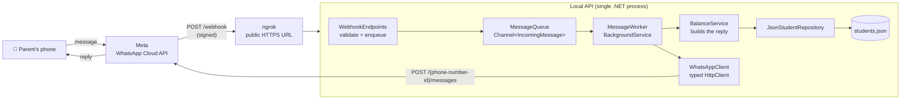
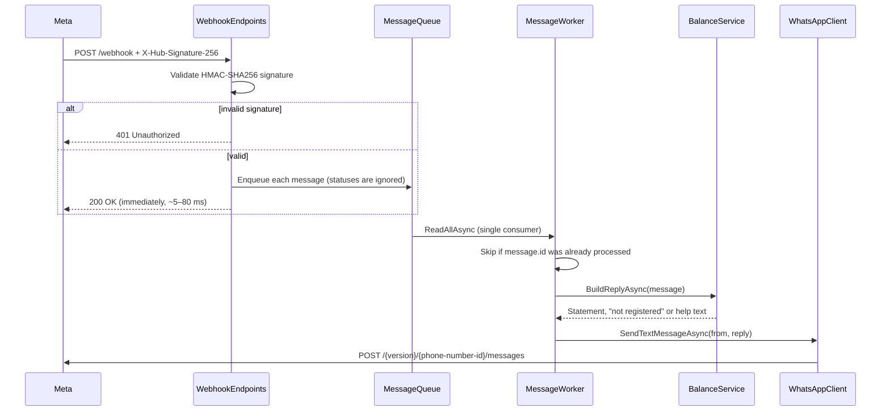
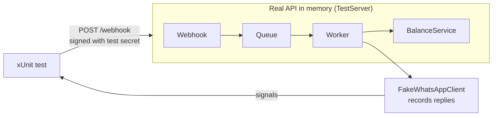

# Architecture

`academy-whatsapp-bot` is a single ASP.NET Core Minimal API that receives WhatsApp messages through Meta's webhooks and replies through the WhatsApp Cloud API. It runs locally and is exposed to the internet with ngrok only while a demo is running.

## Overview

## Request flow

## Project structure

| Folder | Responsibility |
|---|---|
| `Webhook/` | `GET /webhook` verification, `POST /webhook` reception, signature validation, Meta payload DTOs |
| `Processing/` | In-memory queue and background worker |
| `Balance/` | Reply logic (`BalanceService`) and all Spanish user-facing texts (`Messages`) |
| `Data/` | `Student` record, `IStudentRepository` and the JSON implementation |
| `WhatsApp/` | Options and the client that sends messages to the Graph API |
| `Common/` | Phone and text normalization, es-CO currency and date formats |

It is a deliberately simple monolith: one API project plus one test project, organized by feature folders. Interfaces exist only where a test double is needed (`IWhatsAppClient`, `IStudentRepository`).

## Key implementation details

### Webhook verification (`GET /webhook`)

When the webhook URL is registered in the Meta dashboard, Meta sends `hub.mode`, `hub.verify_token` and `hub.challenge`. If the mode is `subscribe` and the token matches `WhatsApp:VerifyToken`, the API returns the challenge as plain text; otherwise `403`.

### Signature validation (`POST /webhook`)

Every event from Meta carries `X-Hub-Signature-256: sha256=<hex>`, the HMAC-SHA256 of the **raw request body** keyed with the app's App Secret.

- The body is read as raw bytes **before** deserializing, because re-serialized JSON would not match the signature.
- The comparison uses `CryptographicOperations.FixedTimeEquals` (constant time) to avoid timing attacks.
- A missing or invalid signature returns `401`, so only Meta can trigger the bot even though the URL is public.

### Background processing (`System.Threading.Channels`)

Meta expects a fast `200` from the webhook. If the webhook waited for the reply to be sent (a second HTTP call to the Graph API), slow responses would make Meta retry and the bot would answer twice.

The webhook is therefore a **producer** that only validates and enqueues, and `MessageWorker` is a **consumer** that processes messages in the background:

- `MessageQueue` wraps an unbounded `Channel<IncomingMessage>` configured with `SingleReader = true`.
- `MessageWorker` is a `BackgroundService` that starts with the app and reads the channel with `await foreach`.
- `IncomingMessage` is a small record that decouples the rest of the app from Meta's payload shape.

No external broker is used: `Channel` is built into .NET, runs in-process and needs no infrastructure, which fits a local proof of concept.

### Deduplication (`IMemoryCache`)

Meta may deliver the same message more than once. Each message has a unique id (`wamid...`), and the worker stores processed ids in `IMemoryCache` for 6 hours; repeated ids are logged and skipped. Because there is a single consumer, a simple check-then-set has no race condition.

### Reply logic (`BalanceService`)

Intent detection is intentionally rule-based (no AI in this phase):

1. The text is normalized: lowercase, accents removed, extra spaces collapsed (`"¿Cuánto DEBO?"` → `"¿cuanto debo?"`).
2. If it contains a balance keyword (`saldo`, `cuanto debo`, `deuda`), the guardian's **active** students are looked up by phone; otherwise, and for non-text messages (audio, images), the help text is returned.
3. No students → "not registered" message. Otherwise a single message lists every student (siblings included): amount, period, due date and payment link, or "al día" when the balance is 0. The "send your receipt" footer appears only if something is owed.

Amounts and dates use the `es-CO` culture: `$120.000` and `5 de diciembre`. All Spanish texts live in `Balance/Messages.cs`, so code, logs and identifiers stay in English.

### Student data

- `data/students.json` holds **fake** data only and is committed. Columns are `snake_case` and mapped to the `Student` record with `JsonNamingPolicy.SnakeCaseLower`.
- For live demos with a real phone, `data/*.local.json` is git-ignored and selected with the `Data:FilePath` setting (in User Secrets).
- The path is resolved against the API project folder and validated at startup; the file is re-read on every query, so it can be edited during a demo without restarting.
- Phones are normalized on both sides (`+57 300 123 4567`, `3001234567` and `573001234567` all match).

### Error handling

- Each message is processed inside its own `try/catch`: a failure is logged and the worker continues with the next message.
- `WhatsAppClient` returns `false` instead of throwing when Meta rejects a request, and logs the Graph API error code and message (e.g. `190` expired token, `131030` recipient not in the test allow list). These are the most common causes of a failed demo.

### Configuration and secrets

- `WhatsAppOptions` is bound from the `WhatsApp` section and validated with data annotations and `ValidateOnStart`: the app refuses to start with a clear error if any value is missing.
- `appsettings.json` contains only empty placeholders. Real values live in .NET **User Secrets** (outside the repository) during local development.
- Phone numbers are masked in logs (`57300***4567`) and secret values are never logged.

## Design decisions

| Decision | Why |
|---|---|
| Single Minimal API project | A proof of concept should stay small; extra layers would add ceremony without value yet |
| `Channel` + `BackgroundService` instead of a broker | Fast webhook responses with zero infrastructure |
| `IMemoryCache` for deduplication | Enough for one local instance |
| Local + ngrok instead of cloud hosting | The bot is only needed during demos; no hosting cost |
| Typed `HttpClient` via `IHttpClientFactory` | Correct connection handling and easy to replace in tests; `PooledConnectionLifetime` because the long-lived worker holds the client |
| Keyword matching instead of an LLM | Predictable and free; an AI agent is planned for a later phase behind the same flow |
| JSON file instead of a database | Zero setup for a demo; `IStudentRepository` allows swapping in Google Sheets or a database later |

## Tests

Run everything with `dotnet test`. No test calls Meta or needs real secrets, so the suite runs the same locally and in CI.

### Unit tests (`tests/.../Unit`)

Phone and text normalization, es-CO formats, keyword detection, `BalanceService` (one student, siblings, up to date, not registered, help, non-text) and `JsonStudentRepository` (snake_case mapping, inactive students). A fake repository replaces the JSON file where needed.

### Integration tests (`tests/.../Integration`)

`WebApplicationFactory<Program>` starts the **real** API in memory (routing, signature validation, JSON, queue, worker, reply logic) and the tests talk to it over HTTP, just like Meta does.

`BotApplicationFactory` changes only what must not be real in a test:

| Real dependency | Replaced by | Why |
|---|---|---|
| `WhatsAppClient` (calls Meta) | `FakeWhatsAppClient`, which records what would have been sent | No cost, no token, works offline and in CI |
| User Secrets | Fixed test settings (environment `Testing`, so User Secrets are never loaded) | A known `AppSecret` lets the test sign its own requests |
| Local data file | `data/students.json` (fake data) | Predictable results |

Covered scenarios: verification with correct/wrong token, invalid and missing signature (`401`, nothing sent), balance statement, siblings, unknown phone, help, status events ignored and duplicate messages answered once. Payloads come from `Fixtures/` and mirror Meta's real format.

**Testing background work.** The webhook returns `200` before the worker replies, so tests cannot assert right after the request. `FakeWhatsAppClient` releases a semaphore on every send and `WaitForMessagesAsync(n)` waits for it with a timeout. For "nothing should be sent" cases (status events, duplicates), the test sends a follow-up message and relies on the queue's ordering: if the ignored event had produced a reply, it would arrive first. This avoids fixed `Task.Delay` waits and flaky tests.

## Known limitations and production path

| Limitation (acceptable for the POC) | Production alternative |
|---|---|
| Queued messages are lost if the app stops | Durable queue (Azure Service Bus, Azure Storage Queues, RabbitMQ) |
| Processed ids are forgotten on restart | Distributed cache (Redis) |
| Works with a single instance only | Shared external queue and cache |
| Runs only while the developer's machine and ngrok are on | Cloud hosting (e.g. Azure App Service or Functions) |

Replacing the queue or the cache would not change the webhook or the business logic, only the registrations in `Program.cs`.
